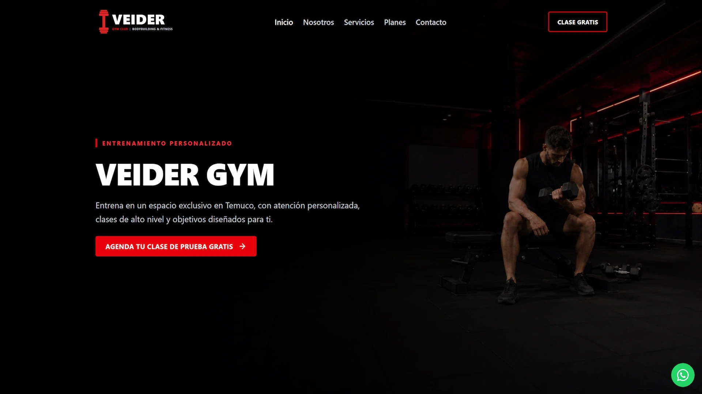

# Veider Gym

Landing page desarrollada para un gimnasio en Temuco, Chile, enfocada en presentar sus servicios, planes de entrenamiento y canales de contacto mediante una interfaz moderna, responsive y orientada a conversión.

🌐 **Demo:** https://veider-gym.netlify.app/



## Sobre el proyecto

El objetivo del proyecto fue desarrollar una landing page profesional para un gimnasio, utilizando una arquitectura basada en componentes y priorizando rendimiento, accesibilidad y una experiencia de usuario clara.

El sitio incluye:

- Hero principal con llamada a la acción.
- Sección informativa sobre el gimnasio.
- Servicios y modalidades de entrenamiento.
- Planes presentados mediante tarjetas reutilizables.
- Formulario de contacto funcional.
- Validación de campos en frontend.
- Integración con Formspree para el envío de consultas.
- Información de contacto y ubicación mediante Google Maps.
- Botón flotante de WhatsApp.
- Diseño responsive para distintos tamaños de pantalla.
- Metadatos básicos para SEO y redes sociales.

## Tecnologías utilizadas

- **Astro 7**
- **Tailwind CSS 4**
- **JavaScript**
- **HTML**
- **CSS**
- **Lucide Icons**
- **Formspree**
- **Netlify**
- **Git / GitHub**

## Arquitectura

El proyecto está dividido en componentes reutilizables:

```text
src/
├── components/
│   ├── Navbar.astro
│   ├── Hero.astro
│   ├── About.astro
│   ├── Services.astro
│   ├── Pricing.astro
│   ├── Contact.astro
│   ├── Footer.astro
│   └── WhatsAppButton.astro
├── layouts/
│   └── Layout.astro
├── pages/
│   └── index.astro
└── styles/
    └── global.css
```

## Características técnicas

### Componentes reutilizables

Las diferentes secciones del sitio se encuentran separadas en componentes Astro para facilitar su mantenimiento y reutilización.

### Renderizado estático

Astro genera una versión estática optimizada del sitio para producción, permitiendo tiempos de carga reducidos y un bajo consumo de recursos.

### Formulario de contacto

El formulario incluye validaciones para nombre, teléfono, correo electrónico y mensaje.

Los datos son enviados mediante `fetch()` a Formspree, permitiendo gestionar consultas sin implementar un backend propio.

### Diseño responsive

La interfaz utiliza un enfoque responsive mediante Tailwind CSS, adaptando navegación, tipografía, contenido y distribución de componentes según el tamaño de pantalla.

### Accesibilidad

Se incorporaron elementos como:

- HTML semántico.
- Etiquetas asociadas a los campos del formulario.
- Atributos ARIA donde corresponde.
- Estados de foco visibles.
- Mensajes accesibles para respuestas del formulario.

### SEO

El layout incluye:

- `title`
- `meta description`
- Open Graph
- Twitter Cards
- idioma `es`
- favicon personalizado

## Instalación

Clonar el repositorio:

```bash
git clone https://github.com/RichiFU/veider-gym.git
```

Entrar al proyecto:

```bash
cd veider-gym
```

Instalar las dependencias:

```bash
npm install
```

Ejecutar el servidor de desarrollo:

```bash
npm run dev
```

El proyecto estará disponible normalmente en:

```text
http://localhost:4321
```

## Build de producción

Generar la versión optimizada:

```bash
npm run build
```

Astro generará los archivos de producción en:

```text
dist/
```

Para probar el build localmente:

```bash
npm run preview
```

## Deploy

El proyecto está desplegado en **Netlify** y conectado al repositorio de GitHub.

Cada actualización enviada a la rama principal mediante:

```bash
git push
```

puede generar automáticamente un nuevo deploy.

## Estado del proyecto

Proyecto funcional y desplegado.

Algunos datos comerciales, como precios definitivos, redes sociales, horarios, dirección exacta y número de WhatsApp, pueden actualizarse posteriormente con la información definitiva del cliente.

## Autor

**Ricardo Fuentes**

Ingeniero Informático  
Desarrollo web y soporte TI